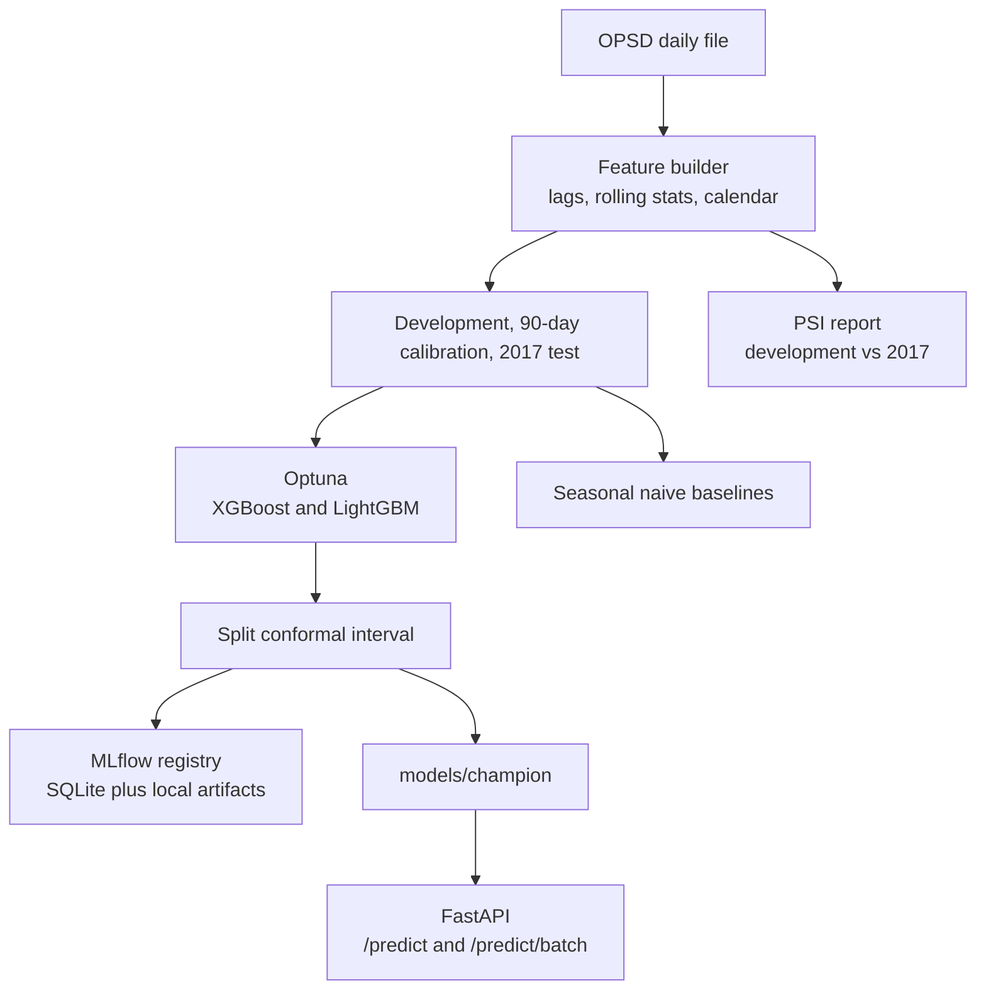

# ml-forecasting-service

Day-ahead forecast of German daily electricity load, built as a small production path: leakage-safe features, a real holdout, a local model registry, and an HTTP scoring service.

The series is Open Power System Data for Germany, 2006-01-01 through 2017-12-31. Each value is energy in gigawatt-hours. The target on day `t` is national consumption, using only information that would have been known at the end of day `t-1`, plus the calendar of day `t`.

[](https://github.com/sydneyani/ml-forecasting-service/actions/workflows/ci.yml)

## Result

Champion: **XGBoost**, model version `5828f2d8d5a4`. Chosen by development-set cross-validation, then scored on 2017-01-01 through 2017-12-31. That year was not used to fit, tune, or set the interval.

| Model | CV MAE (GWh) | Test MAE (GWh) | Test RMSE (GWh) | Test MAPE |
| --- | ---: | ---: | ---: | ---: |
| Naive lag-1 |  | 102.34 | 149.16 | 7.73% |
| Seasonal naive, lag 7 |  | 54.10 | 96.70 | 4.04% |
| Seasonal naive, lag 364 |  | 34.68 | 63.83 | 2.60% |
| LightGBM | 15.78 | 18.28 | 26.19 | 1.34% |
| XGBoost (champion) | 15.31 | 18.16 | 25.66 | 1.33% |

Test MAE is 0.336 times the weekly naive and 0.524 times the yearly naive. Mean error (prediction minus actual) is -3.50 GWh. A 90% split-conformal band has half-width 47.74 GWh and covered 94.5% of 2017. The search that produced this table took 61 seconds. Every figure is copied from [`reports/backtest_results.json`](reports/backtest_results.json).

## Architecture



Training and serving call the same feature function. The API reads the champion directory. It does not call MLflow on the request path.

## Quickstart

```bash
python -m venv .venv
source .venv/bin/activate
pip install -e ".[dev]"
pytest
python -m forecasting.serving
```

The champion artifact is already in the tree, so the server starts without a training run. In another shell:

```bash
curl -s localhost:8000/health
curl -s localhost:8000/ready
```

`/ready` returns the model version and the 2017 test MAE. `POST /predict` needs the target date and at least 364 daily load observations before it. `tests/test_api.py` builds that request from the vendored file and checks the response against `reports/test_predictions.csv`.

Retrain and register:

```bash
python -m forecasting.training --config configs/train.yaml
python -m forecasting.tracking.register
python -m forecasting.monitoring.drift
```

`configs/ci.yaml` is the same protocol with two XGBoost trials. `python -m forecasting.data.download` refreshes the CSV only when the pinned SHA-256 still matches.

## API

| Route | Role |
| --- | --- |
| `GET /health` | Process is up. |
| `GET /ready` | Champion is loaded. 503 until it is. |
| `POST /predict` | One target date plus history. |
| `POST /predict/batch` | Several target dates, one shared history. |

Batch scoring does not write a prediction back into the history. Each date is forecast from observed load only. There is no authentication. Do not expose this process as a public endpoint.

The image in the `Dockerfile` installs the serving extra, copies `models/champion`, and runs the same module. `libgomp1` is there because the boosted libraries link against it.

## Layout

| Path | What it is |
| --- | --- |
| `src/forecasting/features/build.py` | The only feature definition. |
| `src/forecasting/training/backtest.py` | Holdout, search, interval, artifact. |
| `src/forecasting/tracking/registry.py` | Local MLflow run and `champion` alias. |
| `src/forecasting/serving/app.py` | HTTP API. |
| `src/forecasting/monitoring/psi.py` | Population stability index. |
| `configs/train.yaml` | The run behind the table above. |
| `docs/WALKTHROUGH.md` | How to talk through the design. |
| `docs/MODEL_CARD.md` | Scope, metrics, and limits of the champion. |

## Drift

`reports/drift_report.json` compares feature distributions in the development window with 2017. Six features sit at or above PSI 0.2. Daily load itself is at 0.14 and does not alert. Wind lags do, because 2017 wind generation is much higher than the earlier years. Smoothed rolling means alert more loudly: 2017 has no weekly average in the bottom decile of 2006–2016, and an empty bin inflates PSI. The [walkthrough](docs/WALKTHROUGH.md) shows the histogram behind that number. CI writes a fresh report and does not fail the build on an alert.

## Data

The vendored file is `opsd_germany_daily.csv` from [jenfly/opsd](https://github.com/jenfly/opsd), SHA-256 `729b025d984497827cb6b89048d7c2c6a551e7aa727bc47ea0b74a2d1e84675d`. The notebook in that repository builds daily gigawatt-hours from Open Power System Data hourly megawatts for Germany, complete years 2006–2017. Cite Open Power System Data, Data Package Time series. Upstream series can carry source-specific terms: [OPSD legal notes](https://open-power-system-data.org/legal/).

## Development

```bash
ruff check src tests && ruff format --check src tests
pytest
python -m forecasting.training --config configs/ci.yaml
pytest tests/test_ci_score.py
```

GitHub Actions runs that sequence on every push and pull request. The published 2017 metrics are checked against the README, the model card, and the walkthrough, so a copied number has to match the JSON.
